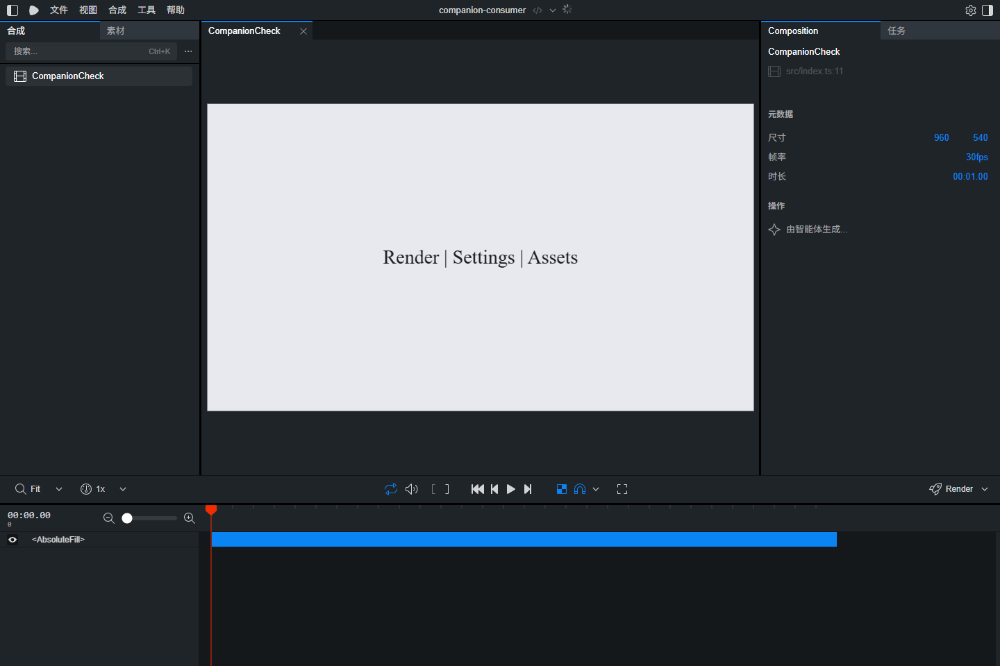

# Remotion Studio 中文扩展

**Remotion 汉化语言包 / Chinese language pack for Remotion Studio**

与 Codex 中的官方 Remotion 插件配合，安装一次，后续由 AI 自动使用中文入口打开项目。无需逐个项目手动配置，也不改写官方 Studio 安装文件。

当前版本：**0.3.0-alpha.0**。已有常用界面翻译，尚未覆盖全部文字；这是独立社区扩展，并非 Remotion 官方中文版。

## 给 AI 的一句话安装

> 安装(https://github.com/a13409512853-maker/remotion-studio-zh)：先读取 INSTALL.md，优先接入 Remotion 技能，仅在权限受限时回退全局指令，保留现有项目配置，完成后检查安装状态；有可用项目时验证中文界面。

用户只需提供仓库链接与这句话，AI 根据安装说明完成依赖安装、插件登记和路由接入。必要的文件访问权限仍由用户确认；这不是在任意 AI 聊天窗口都能执行的远程安装服务。

## 项目特点

| 特点 | 对使用者的帮助 |
| --- | --- |
| 安装一次，自动走中文入口 | 在 Codex 中打开、新建或重新预览 Remotion 时，无需逐项目手动修改 |
| 优先接入 Remotion 技能 | 汉化指引只随 Remotion 功能加载；局部写入被拒绝时才使用全局备选 |
| 语言包独立于官方插件 | 官方 Remotion 插件更新不会直接覆盖扩展目录 |
| 在构建时翻译 | 保留官方安装文件，升级后无需重新改写 `node_modules` |
| 保留原工程配置 | 自动读取原配置、相对导入、自定义别名及原有构建覆盖 |
| Webpack 与 Rspack | 两种构建器均做过真实 Studio 界面验证 |
| JSON 词典与英文模式 | 便于补充译文、调整用词，也可请求英文预览 |
| 不翻译项目视频内容 | 翻译范围限于 Studio 包，保持用户合成源码与文字原样 |
| 开放协作 | 欢迎任何人提交翻译、问题、文档和代码改进 |



截图中仍有英文，反映当前 alpha 版的实际覆盖情况。

## 升级后还能用吗

**接入方式会保留，但不能保证未来所有版本永久完整汉化。**

- **官方 Codex Remotion 插件升级**：独立运行目录保留；写入官方技能的短指引可能被覆盖，需要在下一次调用扩展时修复，或运行 `npm run routing:repair`。这不等于缓存修改永不丢失。
- **项目内 Remotion 升级**：启动器每次解析当前项目的 CLI 和 Studio，重新从新版本构建中文界面。
- **上游新增或改写文字**：未匹配的文字保留英文，需要更新词典。
- **不支持的版本或接口变化**：可能提示、回退英文或需要扩展适配。

已经实际验证过 Remotion **4.0.535、4.0.539**，并运行官方升级器完成过 **4.0.535 → 4.0.539** 的升级测试。测试详情见 [验证记录](docs/VALIDATION.md)。

## 快速开始

环境要求：本地 Codex、Node.js **22.12 或更新版本**，以及需要预览的 Remotion 工程。当前本机安装与浏览器验证在 Windows 完成，其他系统尚未做端到端安装验证。

完整步骤见 [INSTALL.md](INSTALL.md)。手动安装时，在持久保存的仓库目录运行：

```powershell
npm ci --ignore-scripts
node scripts/install-local.cjs "<codex.js 或原生 Codex 可执行文件的绝对路径>"
```

安装器会：

1. 通过 Codex 自带命令登记本地插件市场并安装中文扩展。
2. 优先在 Remotion 入口和 Studio 技能中添加一小段有标记的接入指引，保留原技能内容。
3. 接入成功时移除旧版全局段落；只有局部写入被权限拒绝时才写入全局 `AGENTS.md` 备选，并备份原内容。

安装后可新建聊天，直接说“打开这个项目的 Remotion Studio”。Remotion 技能中的局部指引会引导 Codex 使用中文启动器，无需在每个工程里安装语言包，也无需常驻一整段全局汉化指令。独立扩展仍保留一条可发现的技能描述；并非零上下文开销。

此自动化依赖 Codex 遵循技能和路由规则；它不在系统层拦截其他程序。

## 独立启动

```powershell
node scripts/launch.cjs doctor --project "<项目路径>"
node scripts/launch.cjs studio --project "<项目路径>" -- src/index.ts
node scripts/launch.cjs studio --project "<项目路径>" -- src/index.ts --rspack
```

已有自定义配置也可以继续传入：

```powershell
node scripts/launch.cjs studio --project "<项目路径>" -- src/index.ts --config custom.config.ts
```

英文预览：

```powershell
node scripts/launch.cjs studio --project "<项目路径>" --locale en -- src/index.ts
```

`--` 后的参数会传给该项目自己的 Studio。启动器默认加入 `--no-open`，由 AI 打开实际输出的本地 URL。

## 工作原理

```text
Codex 官方 Remotion 工作流
          |
   Remotion 技能中的局部接入指引
          |
   读取原项目配置 + 生成项目外启动配置
          |
   独立 JSON 词典 + JavaScript 结构匹配
          |
   Webpack / Rspack 构建中文 Studio
```

翻译只作用于解析到的 `@remotion/studio/dist` 文件中的指定界面属性。通过 JavaScript 结构匹配替换静态文字，同时保留功能参数、比较表达式和项目合成源码。不能解析的模块会保留原代码并提示。

## 当前限制

- 常用界面之外仍有漏翻；动态文字、复杂表达式、服务端错误及其他包的内容可能保持英文。
- 没有往官方设置窗口添加原生语言切换按钮，语言改变后需要重新启动。
- 只在外部终端运行 `npx remotion studio`，或自己调用 Node `bundle()` 时，不会自动经过此启动器。
- 移动持久安装目录、卸载扩展或技能接入指引被替换后，需要重新安装或修复接入。
- 尚未完成全部弹窗、编辑操作及视频渲染的回归验收。

## 参与贡献

欢迎任何人参与，无需邀请、付费会员或签署额外 CLA。可以补充翻译、报告漏翻、验证新版本、改进文档或提交代码。

请先阅读 [CONTRIBUTING.md](CONTRIBUTING.md)。翻译修改主要位于 `locales/zh-CN.json`；代码修改应附带可复现说明及相关测试。

本项目使用 **[Unlicense](LICENSE)**，以尽量减少对复制、修改、分发和使用本项目原创代码的限制。第三方依赖及 Remotion 本身仍遵循各自许可证，详见 [NOTICE.md](NOTICE.md)。

## 开发检查

```powershell
npm ci --ignore-scripts
npm test
npm run check
```

仓库附带 GitHub Actions，提交或 PR 时会运行 Windows/Linux 的基础测试。工作流存在不代表它已经在 GitHub 运行成功；以具体提交的实际结果为准。

## 卸载

通过 Codex 插件管理器卸载 `remotion-studio-zh@remotion-zh-local`，从 Remotion 技能删除 `remotion-studio-zh:skill:start` 到 `remotion-studio-zh:skill:end` 的专用段落；如曾使用全局备选，也删除对应全局标记段落。备份位于持久安装目录的 `backups/`，应保留用户后来新增的内容，不宜整份覆盖恢复。

接入状态与修复：

```powershell
npm run routing:status
npm run routing:repair
```

普通修复只尝试局部技能，不会新加全局备选。确有写入权限限制且接受全局备选时，可显式运行 `node scripts/repair-routing.cjs repair --allow-global-fallback`。本项目没有后台监听、定时任务或每次聊天启动的修补钩子；官方插件升级后的自动恢复仍依赖再次调用扩展或执行修复。

## 相关项目与搜索词

项目关键词：**Remotion 中文、Remotion 汉化、Remotion Studio 中文版、Codex 插件、独立语言包、AI 安装、升级保留汉化、Chinese language pack、i18n、localization、Webpack、Rspack**。

- 灵感来源：[yinbaozong/remotion-zh](https://github.com/yinbaozong/remotion-zh)。
- 本项目未包含或执行其原始正则补丁脚本，采用独立的构建加载机制。
- [Remotion 构建器接口](https://www.remotion.dev/docs/bundlers)
- [Codex 插件](https://developers.openai.com/codex/plugins/)
